

  <a href="https://github.com/Simon3Sarkis/super-odyssey-pc-recomp/releases/latest"><b>Download</b></a> ·
  <a href="#install">Get started</a> ·
  <a href="docs/STATUS.md">Status</a> ·
  <a href="#known-issues">Known issues</a> ·
  <a href="docs/ENGINEERING-NOTES.md">Engineering notes</a> ·
  <a href="https://github.com/Simon3Sarkis/super-odyssey-pc-recomp/issues">Issues</a>

<a href="https://recomplauncher.com/game/super-odyssey-pc-recomp"><picture><source media="(prefers-color-scheme: dark)" srcset="https://recomplauncher.com/assets/press/launcher/badge-light.svg"></picture></a>

**Super Odyssey PC Recomp** is a native PC port of *Super Mario Odyssey* (Nintendo Switch, versions 1.0.0 and 1.4.1)
for Windows, Linux and the Steam Deck, made by static recompilation and built on your PC from your own copy of the
game.

  <a href="docs/media/shot-1-metro-street.jpg">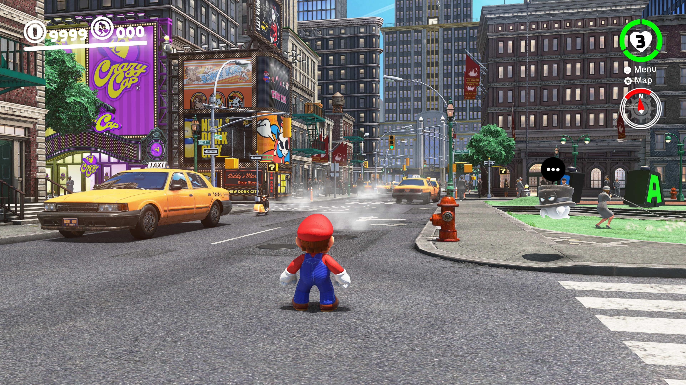</a>
  <a href="docs/media/shot-2-cap-moon.jpg">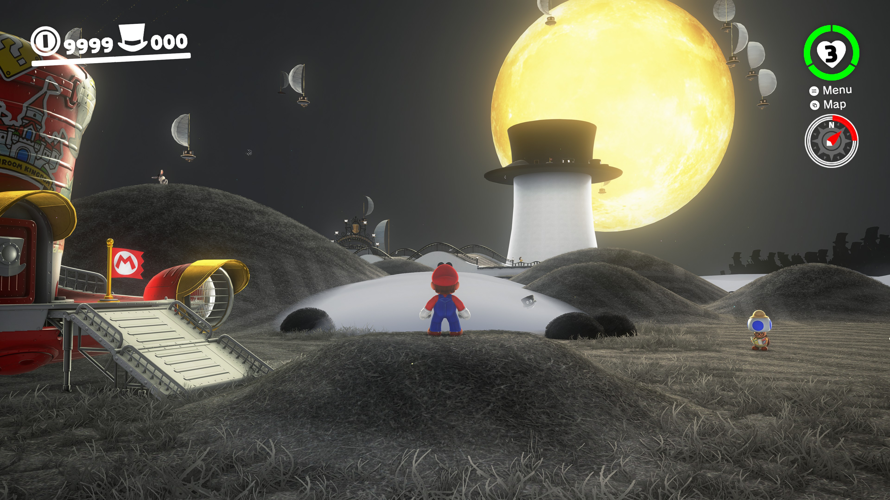</a>
  <a href="docs/media/shot-3-cascade-falls.jpg">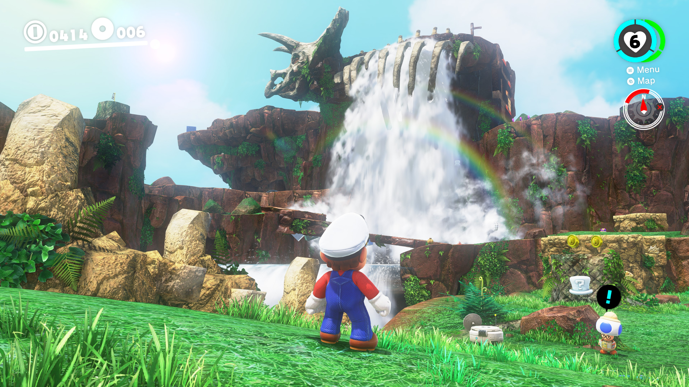</a>
  <a href="docs/media/shot-4-sand-town.jpg">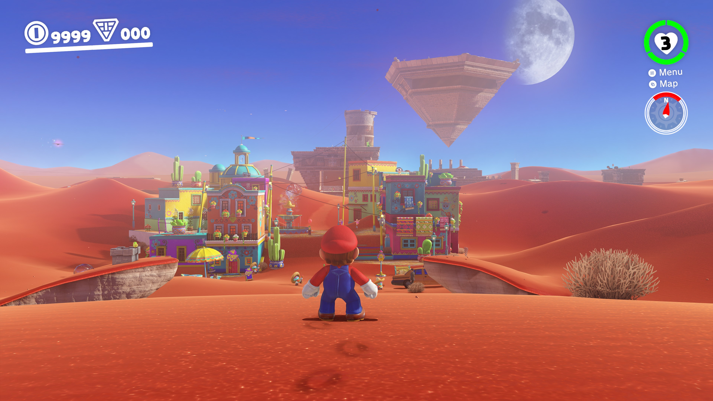</a>

  <a href="docs/media/shot-5-wooded-forest.jpg">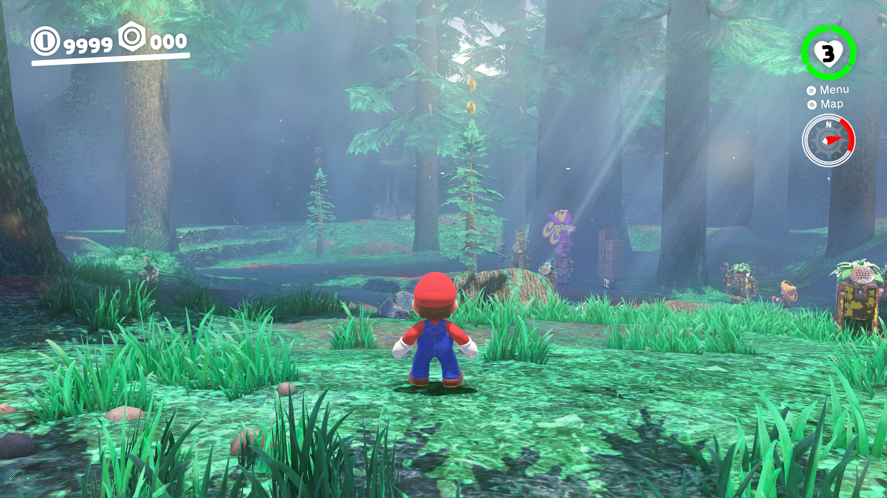</a>
  <a href="docs/media/shot-6-sand-odyssey.jpg">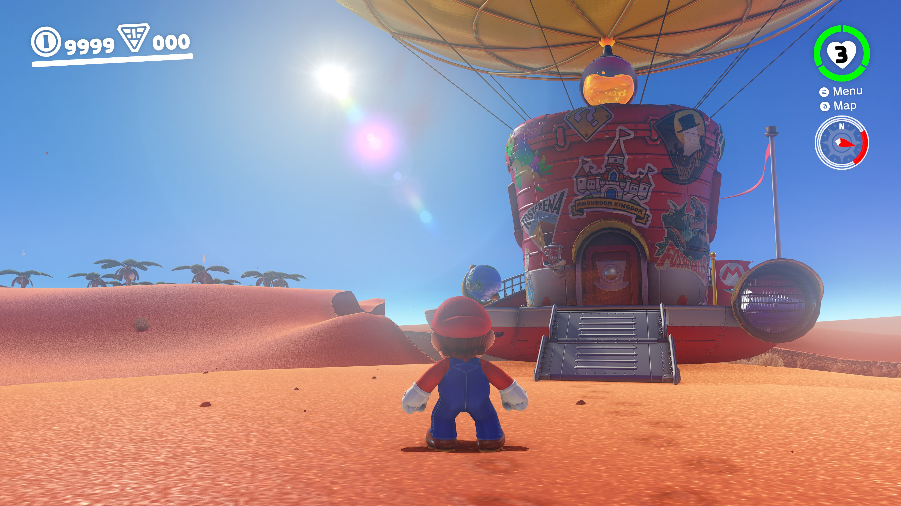</a>
  <a href="docs/media/shot-7-lost-dusk.jpg">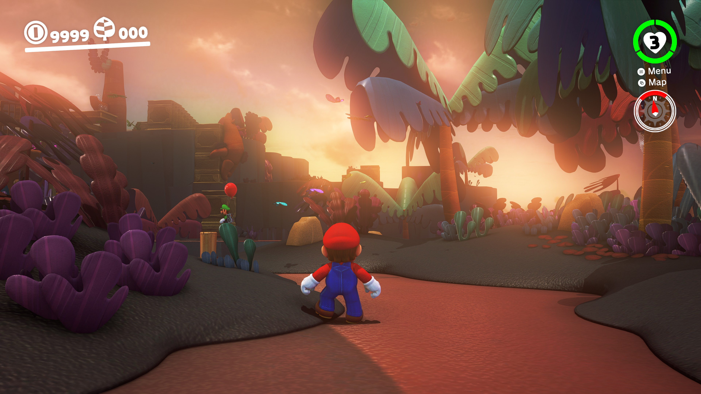</a>
  <a href="docs/media/shot-8-metro-rooftop.jpg">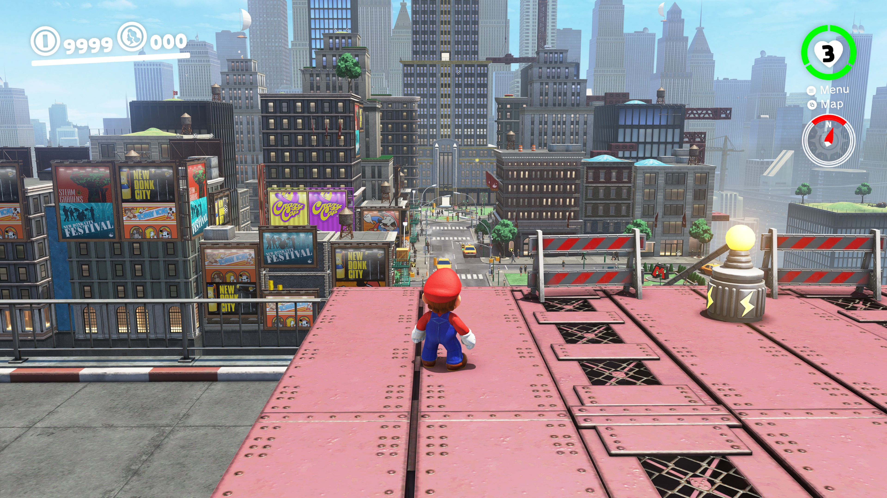</a>

Screenshots taken in Super Odyssey PC Recomp at 3840 x 2160 (click for full size). The game is © Nintendo; you need your own copy to run it.

> [!IMPORTANT]
> **You must bring your own game.** This project contains **no game files, no game code and no assets** -
> only the installer and the source code. To play, you need the **`exefs` and `romfs` folders of your own copy of
> Super Mario Odyssey**, already extracted. Instructions for getting game files are
> not provided, and requests for game files will be closed.

> [!NOTE]
> **This is an AI-made project.** The code of this port was written by AI: almost all of it by **Claude**
> (Anthropic's AI model, through Claude Code), with some fixes and features from OpenAI's **Codex**. The maintainer
> doesn't write the code; they direct the work, test every build on Windows and a Steam Deck, and run the releases.
> See [Who made this](#who-made-this).

> [!WARNING]
> **This is an early preview.** The whole game can be played, but there are known issues (see
> [Known issues](#known-issues)) and things that still need fixing. If something breaks at a high frame rate, set
> **Performance > Frame rate** to 60 for that moment, and please report what you find.

## Features

- **The whole game from your own copy**, versions 1.0.0 and 1.4.1 - no emulator runs while you play
- **60 FPS on a Steam Deck**, and at 60 FPS on integrated graphics such as the Radeon graphics built into a Ryzen 9
  9950X3D
- **Frame rates from 60 to 240 FPS**, with **Match display** picking the smoothest rate for your screen (above 60 is
  less smooth than 60 for now: see [Known issues](#known-issues))
- **Resolutions up to 4K and beyond** (up to 4x the Switch's), and any screen shape: **Fill window** takes the
  window's own shape - wider than 16:9 shows more at the sides, and with **Narrow picture view > Full width** narrower
  screens (16:10, 4:3) show more above and below - or a fixed 16:9, 16:10, 21:9, 32:9 or 4:3 with bars
- **Upscaling** with NVIDIA DLSS / DLAA, AMD FSR 1 / 2 / 3.1 / 4 and Intel XeSS, the HUD drawn at full resolution over
  the upscaled picture, plus **frame generation** (AMD FSR, NVIDIA DLSS beta) and NVIDIA Reflex
- **Shaders prepared before you play**, and again by themselves after a driver update or an update of the port, so
  they are not compiled while you play (a rare effect nobody has recorded yet can still hitch once)
- **Native code where it counts**: some of the game's heaviest work runs as native PC code instead of recompiled
  Switch code - unpacking the game's files when a kingdom loads takes much less CPU, with fewer drops right after
- **Much lower memory use** than the first versions, and a Low memory option for PCs with less RAM
- **Sharper than the Switch when you want it**: FXAA or SMAA, 2x / 4x shadow maps, texture detail, bloom, draw
  distance, 16x anisotropic filtering, smooth colour gradients, a sharper HUD on large screens - and **the Switch's own
  look by default**
- **Any controller**, with button icons that match it (Xbox, PlayStation, Switch), a Joy-Con pair and vibration;
  **keyboard and mouse** with a real mouse camera, and the mouse in the game's own menus
- **Gyro / motion controls** with DualSense, DualShock 4, Switch Pro, Joy-Con, 8BitDo and the **Steam Deck's own
  gyro** (also with Steam Input on): shake to throw Cappy, motion aiming, binoculars; sensitivity, inversion,
  calibration and a shake button
- **A settings menu with a live picture**: tabs along the top, every option saying what it does and what is
  recommended, and the game itself shown while you change graphics settings - made for controller, mouse and keyboard,
  in English, Korean and Brazilian Portuguese
- **Steam Deck and PC handhelds**: 1280 x 800 at 60 FPS in Gaming Mode, a native Linux AppImage
- **Built-in updates**, RomFS mods, 5.1 surround, a performance overlay, Discord activity (off by default)
- **Crash reports you can read**: what happened, where, and a signature to match the same crash between players -
  also when the game is started from a launcher

<a href="docs/media/cap-120fps-4k-overlay.jpg">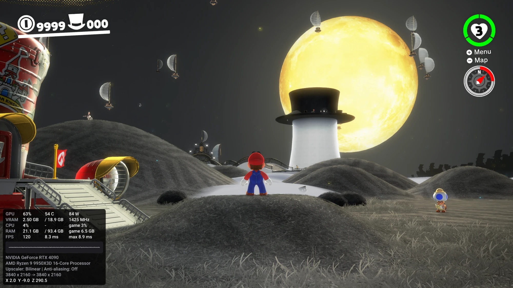</a>

Cap Kingdom at 3840 x 2160 and 120 FPS with the port's own performance overlay (0.4.4, upscaling and anti-aliasing off): the graphics card at 63%, the game using 3% of the CPU and 6.5 GB of RAM. One PC, an RTX 4090 with a Ryzen 9 9950X3D; other PCs and busier places will show other numbers.

  <a href="docs/media/start-screen.jpg">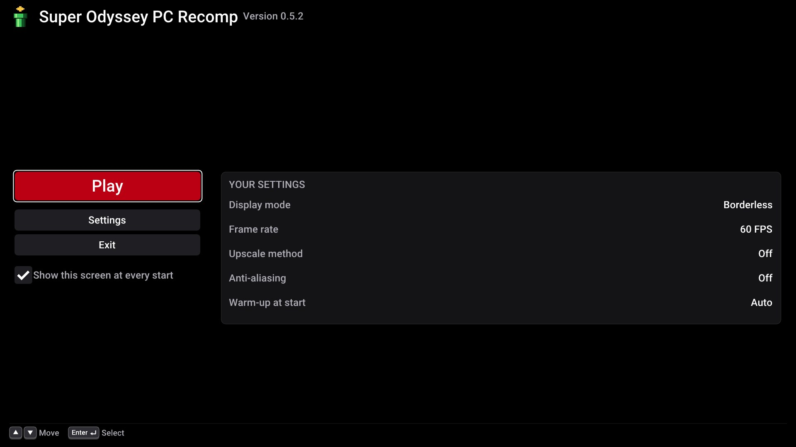</a>
  <a href="docs/media/settings-in-game.jpg">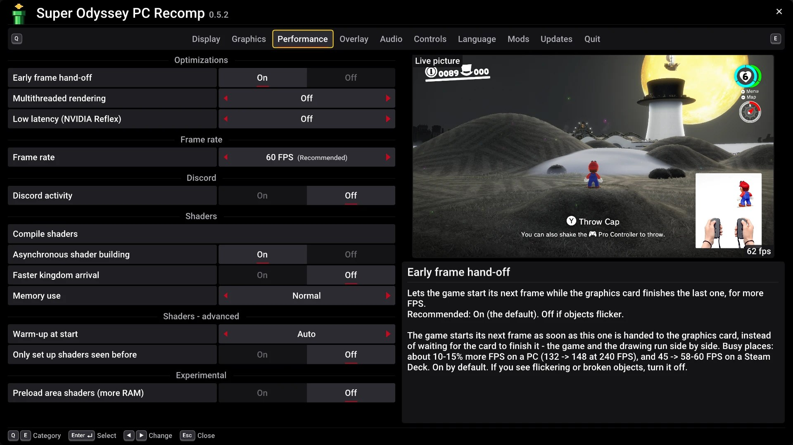</a>

The start screen and the settings menu in game (0.5.3): Play first, categories as tabs along the top, every option explained, and the game's live picture on the right.

## Status

| Area | Share | Progress |
|---|---|---|
| Core game | 45% |  |
| Platforms and input | 15% |  |
| Performance | 15% |  |
| Graphics options | 12% |  |
| Player features | 13% |  |

Every part, what it means, what holds it back and how the average is calculated: [Status](docs/STATUS.md).

**Current focus:** no crashes, steady memory and no frame drops, then the open [issues](../../issues) - the plan is in
[docs/stability-plan.md](docs/stability-plan.md). Releases only go out after the release build itself has been
played on Windows and checked on Linux.

## What it is

The game's ARM64 code is translated to C ahead of time and compiled into a regular program on your PC - no emulator
runs while you play. The parts of the Switch the game talks to (kernel, system services, the NVN graphics API, audio)
are reimplemented on the PC, with Vulkan for graphics.

Windows 10 / 11 (x64). **Linux and Steam Deck: experimental** - an AppImage, see [docs/linux.md](docs/linux.md).

## Install

1. Download the latest `...-windows.zip` from [Releases](../../releases) and extract it anywhere
   you own (for example `D:\Games`, **not** Program Files). Start `SuperOdysseyRecomp.exe`.
   It isn't code-signed: if SmartScreen says "Windows protected your PC", choose *More info*, then *Run anyway*.
2. The installer asks for:
   1. **Your game**: the folder that holds the extracted **`exefs`** and **`romfs`** folders of your own Super Mario
      Odyssey - version **1.0.0**, or **1.4.1** with the update already applied (its full `romfs`, not only the
      update's). `exefs` holds `main`, `main.npdm` and `sdk`; `romfs` holds folders such as `StageData` and
      `SystemData`.
   2. **Install the game to**: where the game data, saves and shaders go (about 12 GB).
3. Press **Install**. It copies the game data, recompiles the game code for your PC (a few minutes) and compiles every
   shader (several minutes, once).
4. Press **Play**. Every start then shows the start screen: **Play** (already selected: A, Enter or Start),
   **Settings** and **Exit**. Untick *Show this screen at every start* to go straight to the game.

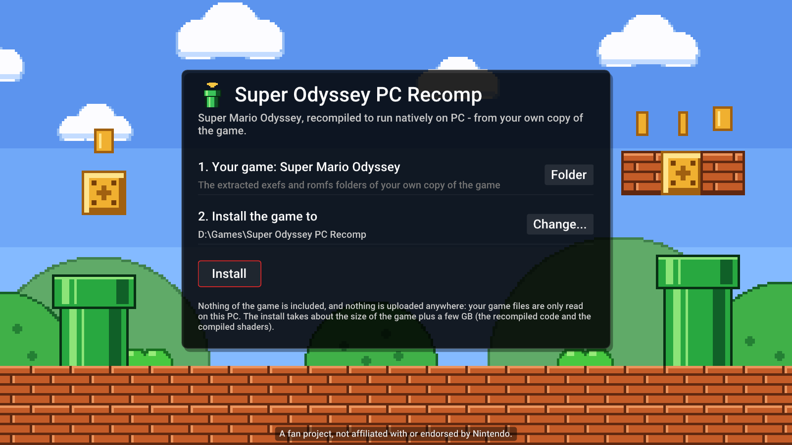

## Updating

New versions are published on this page. The game checks for them at start (in the background - only GitHub is
contacted and nothing about you or your game is sent; you can switch this off) and shows a note when one is out.
Open the menu (**F1**) > **Updates** > **Download and install**, then **Restart now**. Your game files, saves,
settings and mods stay; if the new version needs it, the game code is rebuilt and the shaders re-prepared once, by
themselves.

You can also download the new zip from [Releases](../../releases) and extract it over your current folder.

## Known issues

This is a preview. Known problems and things not done yet:

- **Being worked on** (from the [issues](../../issues)):
  - "Out of graphics memory" a few seconds in on 8 GB laptops with integrated graphics (#120, #99): a fix is being
    tested.
  - Visual corruption in some scenes (#66), running dust drawn as black squares on some AMD cards (#103), effects
    still missing a shader (#104), graphics glitches with Intel graphics on Linux (#98).
  - Low frame rate in Wooded Kingdom on some PCs (#75), and the death screen disappearing (#114).
  - Steam Deck: portable-mode UI scaling (#100).
- **Frame rates above 60** aren't fully smooth yet: the game itself updates 60 times a second, and on 1.4.1 only
  the frames are drawn faster, so motion looks like 60. The busiest places (New Donk City seen from high up, riding its
  power lines) can drop frames on any PC. Painting transitions play at 60 FPS on purpose.
- **Draw distance > Very high** is heavy: in New Donk City it halved the frame rate on a fast PC. High costs almost
  nothing.
- **Version 1.4.1** is newer in this port than 1.0.0 and less tested.
- **A short stutter can still happen** the first time a rare effect is drawn whose pipeline state nobody has recorded
  yet. It's prepared then and kept for next time.
- **Online features** of the game (anything that needs Nintendo's servers) don't work.
- **Code mods** (exefs patches, IPS / pchtxt, online mods) can't be used: the game code is rebuilt from the original.
  RomFS mods work.
- **Windows Defender** may flag the new, unsigned program by its machine-learning guess (a `!ml` detection) - it
  reads game files, builds code and starts helper programs, which looks unusual. Please report it as a false positive at
  https://www.microsoft.com/wdsi/filesubmission and open an issue with the detection name.
- **Linux and Steam Deck are experimental**: less tested than Windows ([docs/linux.md](docs/linux.md)). A Vulkan 1.3
  GPU is required everywhere.
- Graphics glitches can show up in places nobody has tested yet - please report them with a screenshot.

## Reporting a problem

Open an [issue](../../issues) with:

- what happened and where in the game (a screenshot helps),
- your game version (1.0.0 or 1.4.1), Windows version, CPU and GPU,
- the log, `SuperOdysseyRecomp.log`, from the install folder (it doesn't contain any game files),
- after a crash, the **crash report**: the error box has a **Copy crash report** button. The report starts with a
  summary (what happened, where, the stage, your settings) that usually tells us what to fix.

For a graphics glitch, pressing **F9** where it happens saves the frame's details into the log, which helps a lot.

## What you need

- Windows 10 / 11 (x64), a 64-bit CPU - AVX2 (Intel Haswell / AMD Zen or newer) recommended; older CPUs without AVX2
  (Intel Sandy / Ivy Bridge and earlier) are supported but slower - a GPU with Vulkan 1.3 and an up-to-date driver
- 8 GB RAM (16 GB recommended; 8 GB laptops with integrated graphics can run out of graphics memory for now, #120),
  about 12 GB free disk space
- The extracted `exefs` and `romfs` folders of your own Super Mario Odyssey (1.0.0, or 1.4.1 with the update applied)

## Settings

Open the menu with **F1** or **Esc** (controller: Home / Guide button, or Back + Start). The categories are tabs
along the top: L / R (Q / E) switch them from anywhere, Down / A goes into the page, B / Esc comes back. Left / Right
change the selected option. In game, the right side shows the game itself as you change settings, and below it what
the selected option does and what is recommended. The bar at the bottom shows what your buttons do.

- **Display**: windowed, borderless or exclusive fullscreen, display resolution, VSync, aspect ratio, narrow picture
  view, console mode, dynamic resolution
- **Graphics**: internal resolution, anti-aliasing, upscaling and frame generation, texture filtering and detail,
  shadow quality, bloom quality, draw distance, smooth gradients, sharper HUD and menus
- **Performance**: early frame hand-off, multithreaded rendering, frame rate (60 to 240 FPS or Match display),
  Discord activity, shader preparation, memory use
- **Overlay**: the FPS counter, and the performance overlay with what it shows, where and how large
- **Audio**: volume, stereo or 5.1, reverb, movie audio, mute in background
- **Controls**: motion controls (gyro sensitivity, inversion, calibration, shake button), vibration, stick deadzone
  and speed, mouse camera, mouse in menus, button prompts, key and button rebinding
- **Language**, **Mods** (RomFS mods on and off), **Updates**

## Controls

| Switch | Keyboard | Controller |
|---|---|---|
| Left stick | W A S D | left stick |
| Right stick (camera) | mouse, or Num 8 / 4 / 5 / 6 | right stick |
| A / B / X / Y | K / J / L / I | by position (east = A, south = B) |
| L / R, ZL / ZR | Q / E, 1 / 3 | shoulder buttons / triggers |
| + / - | Enter / Backspace | Start / Back |
| Stick clicks | F / Num 0 | stick clicks |
| D-pad | arrow keys | d-pad |

Fullscreen: F11 or Alt+Enter. Everything can be rebound in the menu.

The mouse turns the camera while you play: the pointer stays in the window until you open the menu (Esc) or switch to
another window. Sensitivity, invert up / down, or switching it off: menu > Controls > Mouse.

The game's button icons follow what you play with: after a key press or mouse movement they show the keys you bound
(WASD for moving, a mouse for the camera), after a controller press that controller's own buttons: Xbox (A B X Y,
LB / RB / LT / RT), PlayStation (cross circle square triangle, L1 / R1 / L2 / R2) or the Switch's. With two controllers
connected, the one you press a button on takes over. Menu > Controls > *Button prompts* can fix them to one style.

Motion controls (shake to throw Cappy at a target, motion aiming, looking through binoculars, and the game's other
motion moves) use the controller's gyro and accelerometer: PlayStation, Switch Pro, Joy-Con, 8BitDo and the Steam
Deck's own. On the Deck it works with Steam Input on; leave the gyro unmapped in Steam's controller layout so Steam
doesn't also move the camera with it. Menu > Controls has the gyro's sensitivity, inversion and calibration, a
**Shake button** (throw Cappy with a button instead of shaking) and *Motion controls* to turn them off.

**Switch 2 controllers** (Pro Controller 2, Joy-Con 2) over Bluetooth, on Windows: turn on menu > Controls >
*Switch 2 controllers (Bluetooth)* (`switch2 = 1` in settings.ini) and start the game again. Then hold the small Sync
button on the controller until its lights sweep: the log says `Pro Controller 2 ... paired with this PC`, and from then
on any button reconnects it. Don't pair it in Windows' Bluetooth settings - the game connects it itself, no other
program needed (close bridge programs such as DS4Windows or Steam if it isn't found). Buttons, sticks with the
controller's own calibration, the gyro and accelerometer, player lights and the game's **HD rumble** (both bands'
amplitude and frequency, each side to its own grip) work. A left and a right Joy-Con 2 connected together are one
controller. `switch2 = 2` also logs every Bluetooth LE device it sees, for a report when one isn't found;
`ODYSSEY_SWITCH2_MAP` overrides the motion axes (see `runtime/switch2_proto.h`). Over USB SDL drives them only when it
is built with libusb, which the MSYS2 and upstream Windows builds aren't.

## Files

The program folder holds the program; the install folder (the same one unless you chose another) holds:

- `extracted\` - your game data as the installer wrote it and the game code built from it (`odyssey_game.dll`)
- `save\` - your saves, `cache\` - compiled shaders, `settings.ini` - settings, `SuperOdysseyRecomp.log` - the log
- `mods\` - optional RomFS mods, each in its own folder (`mods\<Mod name>\romfs\...`; the Atmosphere layout works too)

Never share `extracted\` or anything built from it: it's Nintendo's game.

### Brazilian Portuguese fan translation

The separately obtained **JumpManClub Brasil v1.1** RomFS mod can be selected
with **Controls > System language > Português (Brasil)**. It uses the game's
US English slot, and the menu reports whether the complete known package is
enabled without conflicting files. See [installation, limitations and credits](docs/PT-BR.md).
If the translation is missing, selecting the language offers to download and install
the official package. Confirm the installation, then restart when prompted.
No translation files are bundled; no download starts without confirmation.

## Building from source

Needs MSYS2 (UCRT64: clang, SDL3, FFmpeg, shaderc, Python) - `tools\setup_windows.ps1` installs them. See
[docs/BUILD-windows.md](docs/BUILD-windows.md).

1. Put your extracted game folders into `extracted\` (`extracted\exefs\`, `extracted\romfs\`), or start the built
   program and let its installer copy them there.
2. From an MSYS2 UCRT64 shell in this folder:

       make gen        # recompile the game from extracted/exefs into generated/
       make -j16       # build/SuperOdysseyRecomp.exe and the game code, build/odyssey_game.dll
       make dlls       # copy SDL3 / FFmpeg / shaderc DLLs next to the exe

3. A release: `make deps-windows` (an LGPL-only FFmpeg), `make gen-helper`, `tools/fetch_zig.sh`, then `make dist`.
   The zip holds no game code.

## How it works

- `tools/` - the recompiler (Python): `gen.py` lifts every function of the game's NSO modules to C (`lifter.py`);
  `odyssey_patches.py` holds the few game-specific patches for 1.0.0 and 1.4.1.
- `runtime/` - the program: module loader, a small Horizon kernel, IPC services, HLE of SDK functions, NVN on Vulkan
  with a Maxwell shader translator (`runtime/nvn`), movies with FFmpeg, the menu (Dear ImGui), the installer
  (`runtime/ui/setup.mm`), the game code build (`runtime/gamebuild.c`) and the updater (`runtime/updater.c`).
- Debugging tools are environment variables (`ODYSSEY_*`), documented where they're read.

## Who made this

**The code of this port was written by AI, not by the maintainer.** Nearly all of it was written by **Claude**
(Anthropic's AI model, working through Claude Code): the recompiler's patches, the runtime, the Vulkan renderer, the
installer, the Linux version and the release pipeline. OpenAI's **Codex** contributed a number of fixes and features.

The maintainer, [Simon3Sarkis](https://github.com/Simon3Sarkis), hasn't written the code. What they do:

- decide what gets worked on and in what order, and what's good enough to ship
- test every build on their own PC and a Steam Deck, on both game versions, before anything is released
- play through the game to find bugs, reproduce what players report, and compare the port with the Switch version
- run the project: the issues, the replies to players, the releases

Bug reports are read and worked on the same way: the maintainer tests, and Claude writes the fix.

## Credits

- **Power Moon Recomp** by its contributors - the Super Mario Odyssey port this project continues (MIT license); its
  original repository is no longer online.
- **[LAS Recomp](https://github.com/peiikai/LASRecomp)** by Peiikai and its contributors - the static recompiler,
  runtime and renderer Power Moon Recomp is built on, and the frame interpolation (MIT license).
- **[Odyssey Recomp](https://github.com/rwwo8/OdysseyRecomp)** by its contributors - another Power Moon based port of the
  game (MIT license): its list of the shaders drawn in a run through all 197 stages (`known_programs.txt`, merged with
  ours) and its approach of compiling only those, plus the effects, before the first start. Thanks to Eggtooth for the
  side-by-side measurements that pointed to it ([#94](https://github.com/Simon3Sarkis/super-odyssey-pc-recomp/issues/94)).
- **[PrimeRecomp](https://github.com/gminustwo/primerecomp)** by its contributors - the GPU ASTC texture decoder
  (`runtime/nvn/vulkan/astc_gpu.c`) and its GPU scratch memory (MIT license).
- **[MacNativeGames](https://github.com/ly05010419/MacNativeGames)** - the game package reading code `runtime/nxpkg.c`
  is ported from (MIT license, `tools/vendor/macnativegames`), and
  **[TotK PC Recomp](https://github.com/valentderah/totk-pc-recomp)**'s hactool build script (`tools/build_hactool.py`,
  MIT) used for checking
- **[Savage Wind Recomp](https://github.com/Revivedx/SavageWindRecomp)** by Revivedx and its contributors - how the
  motion sensor's orientation is handed to the game, which fixed gyro aiming through binoculars (#53) (MIT license).
- **[mkw-recomp](https://github.com/adriadam10/mkw-recomp)** by Adrià - the Switch 2 controller support over
  Bluetooth LE (`runtime/switch2*.c`, `switch2*.h`; its protocol header from seedds/mkw-neo), as carried over and given
  the game's HD rumble in dkb-pc-recomp (MIT license). The Pro Controller 2's motion axes follow SDL's Switch 2 driver
  (`SDL_hidapi_switch2.c`, zlib).
- **Rekarina** - the settings menu's layout (tabs along the top, a live picture beside the options) was inspired by
  its menu; no code or artwork from it is used.
- [OdysseyDecomp](https://github.com/MonsterDruide1/OdysseyDecomp) - names and structure of the game's code, used for
  reading and debugging (no code from it is in this repository)
- [Switchbrew](https://switchbrew.org) and [envytools](https://github.com/envytools/envytools) - documentation of the
  Switch's system interfaces and the Maxwell GPU
- An MIT-licensed open-source project's audio renderer and shader instruction decoders (`third_party/ryujinx/LICENSE.txt`)
- Libraries: [SDL 3](https://libsdl.org) (zlib), [FFmpeg](https://ffmpeg.org) (LGPL, linked dynamically),
  [Dear ImGui](https://github.com/ocornut/imgui) (MIT), [Vulkan Memory Allocator](https://github.com/GPUOpen-LibrariesAndSDKs/VulkanMemoryAllocator) (MIT),
  [shaderc](https://github.com/google/shaderc) (Apache 2.0), [SMAA](https://github.com/iryoku/smaa) (MIT),
  [AMD FSR 1](https://github.com/GPUOpen-Effects/FidelityFX-FSR) (MIT), the [Roboto](https://github.com/googlefonts/roboto)
  font (Apache 2.0), NVIDIA DLSS (NVIDIA RTX SDK license)
- In the release, to build the game code on your PC: [Zig](https://ziglang.org) (MIT) with LLVM / Clang / LLD (Apache
  2.0 with LLVM exception) and MinGW-w64 headers; the generator runs on [Python](https://www.python.org) (PSF license)
  with [Capstone](https://www.capstone-engine.org) (BSD), [Unicorn](https://www.unicorn-engine.org) (GPL 2.0) and
  [LZ4](https://github.com/python-lz4/python-lz4) (BSD). The release carries every licence in `licenses/`.

The installer's pixel-art background and the icon are original artwork made for this project.

## Contributing

Bug reports, logs and pull requests are welcome - see [Reporting a problem](#reporting-a-problem) for what a report
needs. Every pull request is checked line by line for anything harmful, then built and played on **Windows and a
Steam Deck** before it is merged; nothing from a contributor ships untested. Never include or link game files.

**Contributors**

- **[galaxyhf](https://github.com/galaxyhf) (Caio Silva)** - Brazilian Portuguese: the localization support, the
  Language tab and the fan translation's installer (#49, #56, #58); **Discord activity** and the fix for game
  folders with accents in their path on Windows (#78); **the mouse in the game's own menus** - click, wheel and
  pointer (#86).
- **zzzarathustra-dev** - shaders precompiled before the first start and the first Steam Deck defaults (0.2.1).
- **Codex** (OpenAI) - fixes and features across the runtime (see [Who made this](#who-made-this)).
- Everyone who reported a bug with logs, crash reports, screenshots, videos and saves: most fixes started there -
  the painting crash was found from two players' reports (#72, #85), the frame generation crash from one log (#77),
  the long-session crash from one report (#113), the reversed binocular gyro from a player's video (#53), and several
  reports came with their own investigation (#94, #120, #121). Thank you - keep them coming.

## What we measured and fixed

Versions 0.4.3 to 0.4.5 came out of measuring the port on the maintainer's PC and a Steam Deck, and from players'
logs. This is what was found, what was changed and how it was checked. **The numbers are from one PC** (Windows 11,
RTX 4090, Ryzen 9 9950X3D, 96 GB of RAM) unless a line says Steam Deck; other PCs will show other numbers, and AMD
and Intel graphics cards were not measured.

### How it was measured

Nothing here was judged by feel alone. The tools are in the source, as `ODYSSEY_*` environment variables:

- **A ride recorded once, replayed exactly.** The maintainer played the part that went wrong (the power lines in New
  Donk City; a walk past characters where the sound crackled) once with `ODYSSEY_INPUT_RECORD`. It stores what the
  controller, keyboard and mouse give the game, keyed to the stage's gameplay ticks, so `ODYSSEY_INPUT_REPLAY` plays
  the same route again at any frame rate, before and after a change (`runtime/hle/input.c`).
- **A fixed route through six kingdoms** at 120 FPS, scripted, for memory and hitches.
- **The slow-frame log and a sampling profiler** (`ODYSSEY_LOG_SLOW_FRAMES`, `ODYSSEY_VK_PROF`): every frame over a
  limit with where its time went, and which functions the busy threads were in.
- **The mixer's sound written to a file** (`ODYSSEY_AUDIO_WAV`), the sound before it reaches the sound device, and a
  log of where each voice's signal jumps (`ODYSSEY_AUDIO_CLICKS`).
- **Screenshots of the window** at a set frame, for anything that is about the picture.
- Every release is built by GitHub, and that build itself is played on Windows and started on a Steam Deck before it
  is published (`tools/release.sh`).

### Memory and shaders (0.4.3)

- **RAM:** on the six-kingdom route the game went from 14.7 GB at the start and 15.6 GB at the end to 5.8 GB and
  6.6 GB, at the same frame rate. The largest part was on NVIDIA: its driver held far more memory for shader
  libraries created from saved pipeline binaries than for the same libraries from a normal pipeline cache.
- **First start:** only the shaders the game draws, the effects and the compute shaders are prepared up front (98 s
  before, 44 s after; on a Steam Deck about 6 minutes before, a little over 3 after).
- **Shader cache on disk:** one compressed file instead of tens of thousands (2.2 GB before, under 0.7 GB after).
- The shader list and the idea of compiling only what is drawn come from
  [Odyssey Recomp](https://github.com/rwwo8/OdysseyRecomp); Eggtooth's side-by-side measurements in #94 pointed to it.

### Stutter in heavy views (0.4.4)

- **New Donk City's power lines:** two costs in the port's own code grew with every command list the game records,
  and this view records many. On the recorded ride at 60 FPS, frames longer than 17 ms went from 73 to between 7
  and 18 per ride. At 120 FPS that ride still drops frames, and one long frame in 2 of 7 replays is unexplained.
- **Tried and not kept:** dropping to 60 FPS in such views (it felt worse than the stutter), and reusing shadow maps
  between the frames of one game tick (see Shadows).

### Shadows

- **Stair-stepped shadow edges (#66):** compared on NVIDIA and AMD graphics, these are the game's own shadow map,
  which is low resolution on the Switch too; sharpening (FSR sharpness, CAS) makes the steps stand out.
  **Graphics > Shadow quality** at 2x or 4x softens them. Nothing in the port's drawing of shadows was changed.
- **Shadow maps reused above 60 FPS:** above 60 the game draws its shadow maps again for every extra frame. Keeping
  them from the tick's first frame saves that work, but a shadow could lag a moving object by a frame. It is in the
  source, off (`ODYSSEY_SHADOW_REUSE=1`), because the maintainer did not want any risk to the picture.

### Picture (0.4.4)

- **Ultrawide (#93):** "21:9" is 2.37:1 in the port and a 3840x1600 screen is 2.40:1, which left thin bars and a
  lower resolution. A chosen shape within 3% of the window's now fills the window.
- **16:10 (Steam Deck):** the dark bands behind button hints and tutorial text stopped short of the screen's edge;
  they now reach it. Checked at 1280x800 on the PC.
- **Sharper HUD and menus:** the game's HUD artwork is made for 720 lines and looked soft enlarged. On screens of 900
  lines and more it is sharpened, more on bigger screens, without adding outlines. It makes edges crisper, not more
  detailed, and can be turned off in **Graphics**.

### Sound (0.4.5)

- **Crackling near characters (#97):** the maintainer recorded a walk through New Donk City, the Odyssey and the Cap
  Kingdom with the sound written to a file. The clicks were in the mixed sound itself, not gaps at the sound device.
  Every new sound played its first 5 ms at the volume left behind by the last sound in the same slot, so a quiet,
  distant footstep could start at a loud nearby sound's volume. In about 100 seconds of the replayed walk that
  happened 425 times, with 138 isolated ticks in the output; with a new sound starting at its own volume, as on the
  console, there were none, and the maintainer confirmed it by ear in stereo and 5.1.
- Not listened to on a Steam Deck. Crackling from a busy PC (the sound device running dry) is a different cause.

### Shaders, CPU and the Steam Deck (0.5.0 - 0.5.3)

- **Shader stutter after updates:** the saved shader translations were labelled with the build's time, so every new
  version threw them away and the first kingdom translated thousands of shaders while playing. They are now labelled
  with the translator's own source, and the shipped pipeline seed is checked against each release before it goes out.
- **Native file unpacking:** the game unpacks its compressed files (Yaz0) with recompiled code on a worker thread;
  that function now runs as native code, which took most of the CPU cost out of the drops right after a kingdom loads.
- **Steam Deck hitches:** with 8 CPU threads or fewer the port now runs 2 shader workers and 1 translator instead of
  4 + 2, so they no longer starve the game's main thread; in the bench walk no frame went over 50 ms.
- **Draw distance:** measured in New Donk City at a 120 FPS target - Switch 119 FPS, High 120, Very high 55-61, with
  the time spent in the game's own updates of faraway objects (CPU), not in the graphics card. The menu now says so.
- **Gyro through binoculars (#53):** the motion sensor's orientation was handed to the game the wrong way round (the
  inverse rotation); handed over as Savage Wind Recomp does, both directions are right on a Steam Deck.

### Still open

- Frame drops above 60 FPS in the busiest views, and how much CPU the port uses on a Steam Deck.
- The time from starting the program to the game's first frame (about 7 seconds on the test PC, not broken down yet).
- Everything in [Known issues](#known-issues).

## For other recomp projects

What went wrong here and what fixed it is written up so others don't have to find it twice:

- **[Engineering notes](docs/ENGINEERING-NOTES.md)**: how we test (scripted runs, old and new behaviour back to
  back, release builds tested before they're published), the crashes we hit above 60 FPS, with frame generation and
  on quit, the memory growth, the sound crackling, the ways our own tests misled us - and how the shader stutter was
  solved and the Steam Deck reached 60 FPS.
- **[Performance techniques](docs/OPTIMIZATIONS.md)**: frame pacing, not waiting for the GPU, shader preparation,
  native high frame rates, the HUD after upscaling, any screen shape - each with how it was measured.

The code they point to is MIT licensed: take what helps.

## Legal

This is a fan project. It is not affiliated with, endorsed by or sponsored by Nintendo. *Super Mario Odyssey* and
*Nintendo Switch* are trademarks of Nintendo. No game files, game code, assets or fonts are included in this
repository or its releases, and nothing built from your game files (`extracted/`, `generated/`, `odyssey_game.dll`)
may be shared. You must provide the extracted files of your own legally obtained copy of the game.

## License

The code of this repository is under the [MIT License](LICENSE) (it keeps LAS Recomp's and Power Moon Recomp's
copyright notices). Third-party components keep their own licenses (above, and in `third_party/`). The license covers
this project's code only - it grants nothing for Nintendo's game.
