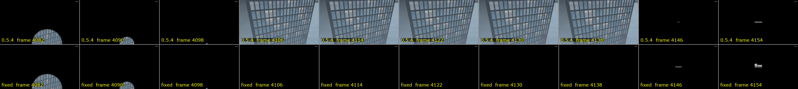

# #114: the scene comes back in the middle of the death screen

Issue #114 ("Death screen disappearing - this happens whenever I die"), reported on 0.5.1, game 1.4.1, New Donk City,
RTX 4060, DLSS native AA, resolution 2x, frame rate 60, frame generation off, 16:9. Same code path in 0.5.4.

## What the player sees

From the issue's video (30 FPS, stepped frame by frame): Mario falls off a roof, the iris wipe closes to black, and
then **the scene is shown again without the wipe for about 0.7 s** (about 40 frames at 60 FPS), until the black screen
with the coin count appears. On the Switch the screen stays black from the closed wipe to the coin count.

## Cause

The HUD layer (runtime/nvn/vulkan/exec.c, "HUD layer"): while it is on, the game's layouts - the wipe is one - are
drawn into a layer at the window's resolution instead of the game's picture, and put over the picture at the present.

When the wipe has closed, the game stops drawing: it **saves its last picture once** (one draw that samples the
picture into another 1600x900 texture) and for the next ~40 frames, while the stage is set up again, it only draws
that saved copy back into its picture. Without the layer the saved picture has the closed wipe in it, so it is black.
With the layer the wipe was never in the picture: the saved copy is the bare scene, and the layer - not drawn into
any more - is dropped as stale. So the scene shows until the coin-count layout starts drawing.

Traced with per-pass logging around the death (frames 4099-4110 of the run below): the last scene frame draws scene +
12 layout draws; the next frame has one draw from the picture into a second 1600x900 RGB10A2 texture and nothing
else; every frame after that has a single draw into the picture and no layout draw.

The layer is on with any temporal upscaler (DLSS / FSR / XeSS, native AA included), with an internal resolution below
the window's, and - since 0.4.4 - for "Sharper HUD and menus" on any window of 900 lines or more. So this is not a
DLSS bug: it also happens with no upscaler on a 1600x900 window (checked), and not on a 1280x720 window without
an upscaler (layer off; that run is the reference for how it should look).

## Fix

`hud_read_flush` (exec.c): when the game reads its picture - a draw sampling it, or a texture copy from it - into
anything but the window's texture while the layer holds layouts that belong to that picture, the layer is put into
the picture first (the existing `hud_flush`, as when the game draws 3D over a menu). The saved copy then has the
wipe in it, as on the console.

This happens a few times a session (once at the title, at stage changes, at a death: 6 times in a run from start to
after one death); in all other frames the HUD stays on the layer. `ODYSSEY_HUD_READ_FLUSH=0` turns it off (as 0.5.4).

It is in the HUD layer's code but does not touch the layer's filtering or placement (hud_sharpness, hud_over.frag,
the 16:10 placement): one new function before `draw()`, one call in `draw_` and one in `copy_texture`.

## Evidence

Scripted run on the test data (1.4.1, save-complete): warp to CityWorldHomeStage, walk off the roof behind the
Odyssey from frame 3600 (stick down + jumps), window shots every 4 frames. RTX 4090, window 1280x720, resolution 2x.

Top row: the 0.5.4 code (this branch before the fix), DLSS native AA: the scene is back from frame 4106 to 4142.
Bottom row: with the fix, same settings: black until the coin count.

| Run | Settings | Result |
|---|---|---|
| before | DLSS native AA, 2x, 60 | scene shown for frames 4106-4142 (as in the issue's video) |
| before | DLSS native AA, `ODYSSEY_HUD_LAYER=0` | black (the layer is the cause) |
| before | no upscaler, 1600x900 window (layer on for the sharpening) | scene shown, same frames |
| reference | no upscaler, 1280x720 window (layer off) | black |
| fixed | DLSS native AA, 2x, 60 | black, same frames as the reference |
| fixed | no upscaler, 1600x900 window | black |
| fixed | DLSS native AA, frame rate 120 | black from the closed wipe to the coin count |
| fixed | handheld console mode, 1280x800, fill, DLSS quality | black |
| fixed vs `ODYSSEY_HUD_READ_FLUSH=0` | pause menu, DLSS native AA | same picture (blurred scene, Mario and Cappy, footer) |
| fixed | pause menu, handheld, 1280x800, fill, no upscaler | background and footer there |

## Not verified

- The released 0.5.4 exe itself was not run for the "before" row: it is this branch's code before the change.
- Only a fall death in New Donk City. Other deaths (damage, poison, lava) and other transitions that use the same
  saved-picture path (stage changes, pipes, doors) were not looked at one by one; the same fix applies to them.
- Frame generation (off in the report), FSR / XeSS, 1.0.0, Linux / Steam Deck, macOS (Metal has no HUD layer).
- Cost: one loop over a draw's textures for each draw (as `resolve_feedback` already does); no frame-rate
  comparison was made.
- No Switch capture was compared; "black until the coin count" is the game's own behaviour without the layer.

## Draft reply for #114 (not posted - for the owner to approve, after the release with the fix)

> Thanks for the video and the report, they made this easy to find.
>
> **Fixed** in the next release (0.5.5): after the wipe closes, the screen now stays black until the coin count,
> as on the Switch. The cause was the sharper HUD layer used with DLSS / FSR / XeSS (and on windows of 900 lines
> or more): the game keeps its last picture during the reload, and the black wipe was missing from it.
>
> **Until then:** it is only visual - nothing is lost and no setting needs changing.
>
> If you still see it after updating, please reopen with a new video.
